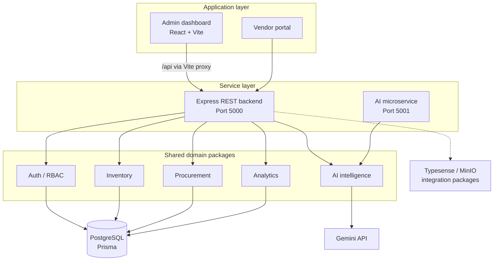

<div align="center">

# ChrisSoft AI

### Procurement intelligence meets everyday business operations.

**An AI-powered B2B procurement and merchant management platform** combining vendor discovery, RFQs, inventory, POS billing, customer management, and business intelligence in one TypeScript monorepo.

[](https://www.typescriptlang.org/)
[](https://react.dev/)
[](https://nodejs.org/)
[](https://www.postgresql.org/)
[](https://pnpm.io/)

**[Overview](#overview) · [Features](#key-features) · [Architecture](#system-architecture) · [Quick Start](#quick-start) · [API](#rest-api-reference) · [Roadmap](#roadmap)**

</div>

---

## Overview

**ChrisSoft AI** brings procurement workflows and merchant operations into a unified workspace. Businesses can manage products, customers, invoices, stock levels, and supplier decisions while using an AI copilot to interpret operational data and support smarter purchasing decisions.

Rather than treating AI as a separate chatbot, ChrisSoft AI connects intelligence features to everyday business tasks: vendor recommendations, demand forecasts, pricing insights, and procurement risk analysis.

> **Project status:** Active development. This README documents the modules and API surface described for the current project; production deployment, model accuracy, and end-to-end integration should be validated separately.

## Key Features

| Area | Capabilities |
| --- | --- |
| **B2B Procurement** | RFQ, purchase-order, quotation, and vendor-management modules |
| **AI Vendor Intelligence** | Vendor matching and scoring against procurement requests |
| **POS & Invoicing** | Checkout, tax and discount calculations, invoice creation, and payment tracking |
| **Inventory Operations** | Product catalogue, stock updates, restocking, warehouse valuation, and stock-health monitoring |
| **Customers & Merchants** | Customer profiles, receivables, loyalty/spend updates, and merchant settings |
| **Business Analytics** | Revenue KPIs, recent sales trends, category distribution, customer lifetime value, and GST reports |
| **AI Business Copilot** | Conversational insights across sales, inventory, and supplier information |
| **Audit Activity** | Timeline for sales, restocks, and customer events |
| **Authentication** | JWT-based sessions with role-based access-control components |

### Two Connected Workflows

**Merchant operations**

`Manage products → Serve customers → POS checkout → Update inventory → Generate invoices → Review analytics`

**Procurement intelligence**

`Define buying needs → Raise RFQ → Evaluate vendors → Assess pricing and risk → Plan purchases and replenishment`

## Technology Stack

| Layer | Technologies |
| --- | --- |
| **Frontend** | React 19, TypeScript, Vite, Tailwind CSS |
| **Backend** | Node.js, Express, TypeScript, REST APIs |
| **Monorepo** | pnpm workspaces, Turborepo |
| **Database** | PostgreSQL, Prisma |
| **Authentication** | JWT, role-based access-control package |
| **AI** | Gemini API integration, internal AI recommendation and forecasting packages |
| **Search** | Typesense integration package |
| **Object Storage** | MinIO / S3-compatible storage package |

## System Architecture



> The diagram shows the **intended module relationships**, not a claim that every optional service is active in the default dev command. The `pnpm dev` workflow described below starts the backend and admin frontend.

## Monorepo Structure

```text
.
├── apps/
│   ├── admin/             # React 19 + Vite merchant dashboard and POS
│   ├── backend/           # Express REST API
│   ├── ai-service/        # Standalone AI service (port 5001)
│   └── vendor-portal/     # Vendor quotation experience
├── packages/
│   ├── ai/                # Gemini integration and intelligence logic
│   ├── auth/              # JWT and role-based access control
│   ├── database/          # Prisma and PostgreSQL schema
│   ├── analytics/         # Business and supplier metrics
│   ├── inventory/         # Stock-management domain logic
│   ├── shared/            # Shared TypeScript types and models
│   ├── search/            # Typesense integration
│   ├── storage/           # MinIO / S3 integration
│   └── procurement/       # RFQs, purchase orders, and quotations
├── start_dev.bat          # Windows Command Prompt launcher
└── start_dev.ps1          # Windows PowerShell launcher
```

## Quick Start

### Prerequisites

- **Node.js** compatible with the repository's `package.json` / engine requirements
- **pnpm** installed and available on your `PATH`
- **PostgreSQL** running if the enabled backend modules require the database
- Environment variables / API credentials configured for any services you enable (such as Gemini)

> Check the app and package configuration for the exact environment-variable names and database setup commands. They are intentionally not guessed here.

### 1. Install dependencies

From the repository root:

```bash
pnpm install
```

### 2. Start backend and frontend together

**Windows — one-click launch**

Double-click either launcher in the repository root:

```text
start_dev.bat
start_dev.ps1
```

**Any supported terminal — Turbo development workflow**

```bash
pnpm dev
```

This starts the **backend API** and **admin dashboard** concurrently according to the root development script.

### 3. Or run each app separately

**Terminal 1 — Backend**

```bash
pnpm --filter @equation-orchestra/backend dev
```

**Terminal 2 — Admin frontend**

```bash
pnpm --filter @equation-orchestra/admin dev
```

### 4. Open the application

| Service | Local URL |
| --- | --- |
| **Admin dashboard** | [http://localhost:3000](http://localhost:3000) |
| **REST API** | [http://localhost:5000](http://localhost:5000) |
| **API health** | [http://localhost:5000/api/health](http://localhost:5000/api/health) |
| **Standalone AI service** | `http://localhost:5001` (when started separately) |

**Development proxy:** The Vite frontend proxies `/api/*` requests from port `3000` to the backend on port `5000`.

**Smoke test:** With the backend running, open [http://localhost:5000/api/health](http://localhost:5000/api/health) to check that the API responds.

## REST API Reference

**Base URL:** `http://localhost:5000/api`

### Authentication — `/auth`

| Method | Endpoint | Purpose |
| --- | --- | --- |
| `POST` | `/auth/login` | Email/password login; returns a JWT |
| `POST` | `/auth/signup` | Register a merchant account |
| `POST` | `/auth/verify-otp` | Verify the current 4-digit OTP flow and create a session |
| `GET` | `/auth/me` | Return the authenticated user profile |

For authenticated routes, pass the JWT in the authorization header:

```http
Authorization: Bearer <your_jwt_token>
```

### Catalogue & Inventory

| Method | Endpoint | Purpose |
| --- | --- | --- |
| `GET` | `/products` | List products; supports `?category=` and `?search=` |
| `GET` | `/products/:id` | Retrieve product |
| `POST` | `/products` | Create product |
| `PUT` | `/products/:id` | Update product |
| `POST` | `/products/:id/restock` | Add stock and log activity |
| `DELETE` | `/products/:id` | Delete product |
| `GET` | `/inventory/summary` | Cost, retail valuation, markup, and stock health |
| `POST` | `/inventory/restock-alerts` | Trigger the bulk replenishment operation |

### Customers, Billing & Auditing

| Method | Endpoint | Purpose |
| --- | --- | --- |
| `GET` | `/customers` | List customers and receivables |
| `GET` | `/customers/:id` | Retrieve customer |
| `POST` | `/customers` | Create customer |
| `PUT` | `/customers/:id` | Update customer |
| `GET` | `/invoices` | List invoices and payment status |
| `GET` | `/invoices/:id` | Retrieve invoice |
| `POST` | `/invoices/checkout` | Checkout, stock deduction, loyalty/spend updates, and invoicing |
| `GET` | `/activities` | Sales, restock, and customer activity timeline |

### Analytics & Settings

| Method | Endpoint | Purpose |
| --- | --- | --- |
| `GET` | `/analytics` | KPIs, 7-day sales, categories, and CLV |
| `GET` | `/analytics/reports` | GST and payment-method breakdowns |
| `GET` | `/settings` | Retrieve merchant/tax settings |
| `PUT` | `/settings` | Update business settings |

> The current GST report breakdown is documented as **9% CGST + 9% SGST**. Tax rates and tax treatment should be configurable and validated for the applicable transaction before production use.

### AI Intelligence — `/ai`

| Method | Endpoint | Purpose |
| --- | --- | --- |
| `POST` | `/ai/chat` | Business copilot for inventory, revenue, and supplier questions |
| `POST` | `/ai/recommend-vendors` | Match and score vendors for an RFQ |
| `POST` | `/ai/forecast-demand` | Estimate 30-day demand and reorder quantities |
| `POST` | `/ai/predict-price` | Provide price-trend projections |
| `POST` | `/ai/analyze-risk` | Assess procurement risk for a purchase order |

**Example health-check request**

```bash
curl http://localhost:5000/api/health
```

Request body schemas, validation rules, and error responses should be taken from the source code or an OpenAPI specification; they are not defined in this README.

## AI Capabilities

ChrisSoft AI is designed around **actionable AI business context**, not just generic AI output.

| Intelligence workflow | Business question answered |
| --- | --- |
| **AI Copilot** | “What is happening to revenue, inventory, or suppliers?” |
| **Vendor Recommendations** | “Which vendors best match this buying requirement?” |
| **Demand Forecasting** | “How much stock might I need over the next 30 days?” |
| **Price Prediction** | “How could input prices change?” |
| **Procurement Risk Analysis** | “What risks should I consider before approving a purchase?” |

AI outputs should support human decisions, not replace supplier verification, stock counts, or financial review.

## Security & Data Integrity

The project includes **JWT authentication** and a **role-based authorization package**. Before a production release, verify that the deployed system also enforces:

- Authorization and merchant-level data isolation on every protected API route
- Secure password hashing, JWT signing-key management, token expiration, and OTP rate limiting
- Request validation, auditability, and sensitive-data handling
- Database transactions and idempotency protection for checkout and stock mutations
- Tested migrations, backups, recovery, and secret management

> Having an authentication package or an “atomic checkout” endpoint is not, by itself, proof that all routes and concurrent transactions are secure.

## Roadmap

The following items are **recommended next milestones**, not claims of completed functionality:

- [ ] Publish a complete `.env.example` with documented configuration keys
- [ ] Add database setup, Prisma migration, and seed instructions
- [ ] Document request/response examples with OpenAPI / Swagger
- [ ] Add integration tests for login, checkout, inventory, and RFQ flows
- [ ] Validate AI recommendations and forecasts against reproducible test data
- [ ] Complete the vendor portal's end-to-end procurement journey
- [ ] Add Docker-based local deployment and production deployment instructions
- [ ] Include UI screenshots, an architecture walkthrough, and a short demo

## Contributing

Contributions are welcome where repository access and project policy permit. For changes, use a focused branch, document the scope, and run the relevant checks for affected packages before opening a pull request.

## Project Vision

**One platform for the operational work and purchasing decisions of a growing business.**

ChrisSoft AI aims to help merchants spend less time switching tools and more time understanding stock, customers, cash flow, and supplier choices.
---

<div align="center">

**ChrisSoft AI — Run the business. Understand the business. Grow the business.**

</div>
